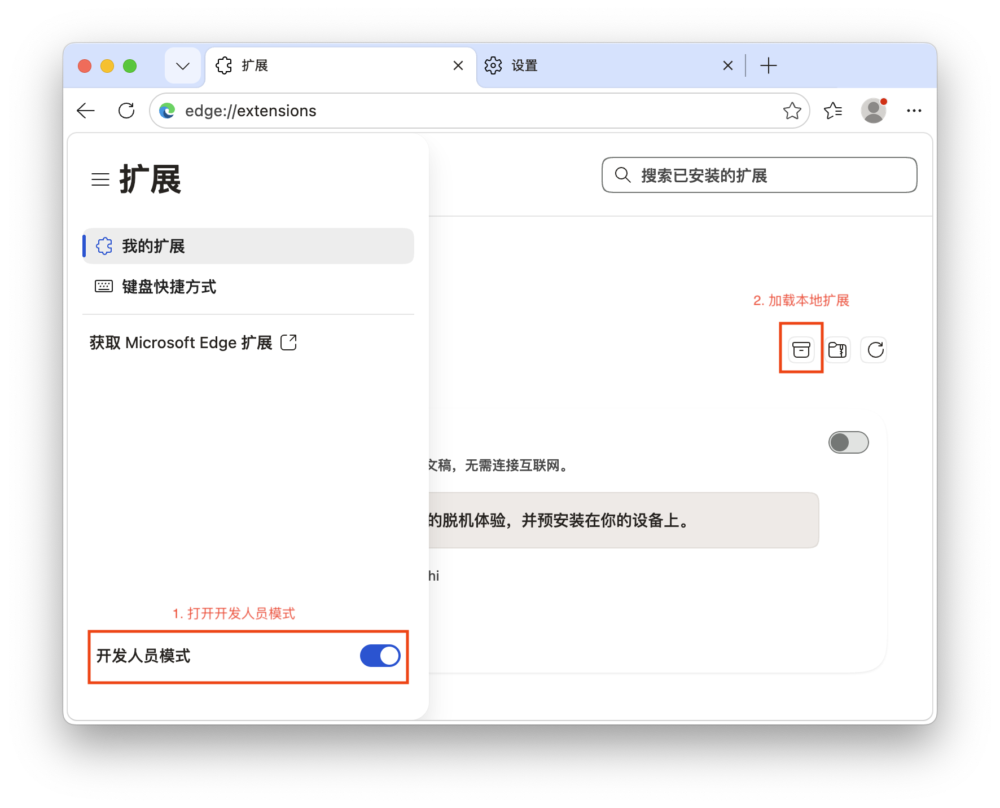
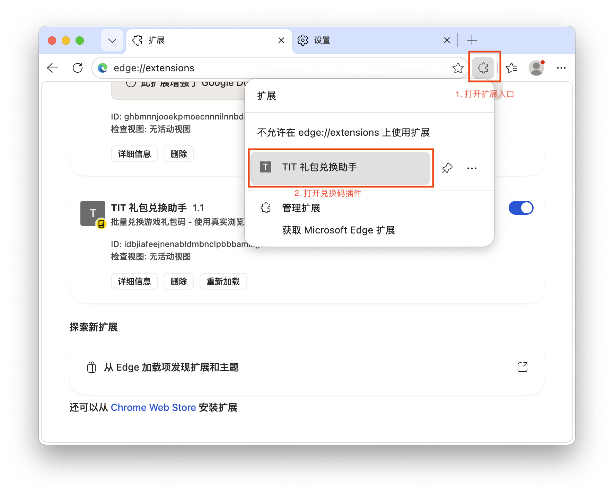
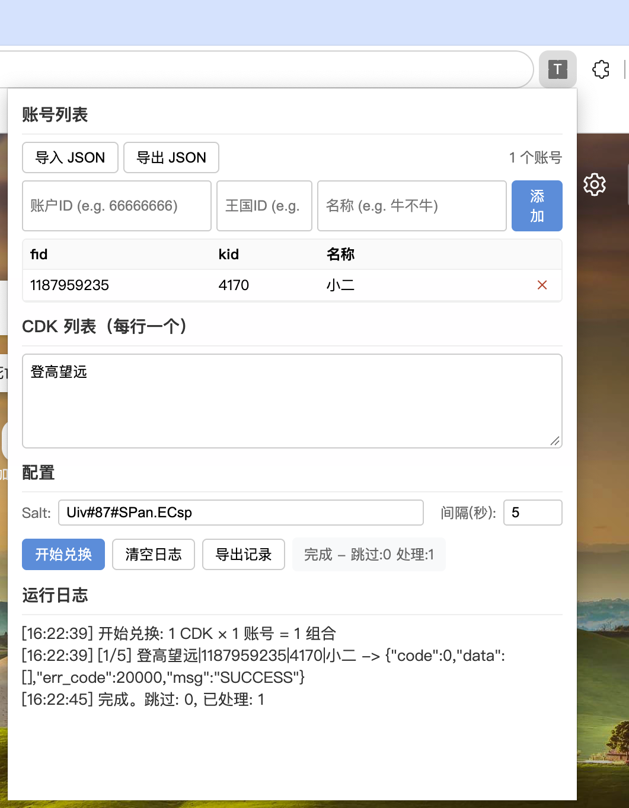

# 无尽冬日兑换码兑换工具

> ⚠️ **免责声明**：
> 
> 本工具仅限个人自用，请勿用于商业用途。
> 利用本工具白嫖牟利者请自重，后果自负。

自动兑换无尽冬日兑换码的工具，提供两种实现方式：

- **Python 脚本**（`main.py`）：适合批量自动化处理，支持命令行操作
- **浏览器插件**（`extension/`）：基于真实浏览器环境，提供可视化操作界面

---

## 方式一：Python 脚本

### 安装依赖

#### 方式一：使用自动安装脚本

Windows PowerShell 用户可以运行一键安装脚本，自动检查 Python 版本、创建虚拟环境并安装依赖：

```powershell
.\setup.ps1
```

> **注意：** 如果遇到执行策略限制，请先运行：
> ```powershell
> Set-ExecutionPolicy -ExecutionPolicy RemoteSigned -Scope CurrentUser
> ```

#### 方式二：手动安装

```bash
# 创建虚拟环境（推荐）
python -m venv .venv          # Windows
python3 -m venv .venv        # macOS/Linux

# 激活虚拟环境
# Windows:
.venv\Scripts\Activate.ps1
# macOS/Linux:
source .venv/bin/activate

# 安装依赖
pip install -r requirements.txt
```

### 使用方法

#### 准备账号文件

创建 `accounts.json` 文件，格式如下：

```json
[
  {
    "fid": "账号fid，即角色id",
    "kid": "账号kid，即区号",
    "name": "角色名称"
  },
  ...
]
```

#### 运行脚本

```bash
# Windows
python main.py -c '礼包码1' '礼包码2'

# macOS/Linux
python3 main.py -c '礼包码1' '礼包码2'
```

#### 参数说明

| 参数 | 简写 | 说明 | 默认值 |
|------|------|------|--------|
| `--cdks` | `-c` | 要兑换的礼包码列表（必填） | - |
| `--accounts` | `-a` | 账号文件路径 | `accounts.json` |
| `--records` | `-r` | 兑换记录输出文件 | `records.json` |
| `--log` | `-l` | 日志文件路径 | `log.log` |
| `--salt` | `-s` | 签名盐值 | 默认内置值 |

#### 示例

```bash
# 兑换单个礼包码
python main.py -c 'WJDR666'          # Windows
python3 main.py -c 'WJDR666'        # macOS/Linux

# 兑换多个礼包码
python main.py -c 'WJDR666' 'WJDR888' 'WJDR999'          # Windows
python3 main.py -c 'WJDR666' 'WJDR888' 'WJDR999'        # macOS/Linux

# 指定自定义账号文件
python main.py -c 'WJDR666' -a my_accounts.json          # Windows
python3 main.py -c 'WJDR666' -a my_accounts.json        # macOS/Linux
```

---

## 方式二：Chrome/Edge 浏览器插件

基于 Manifest V3 的浏览器扩展，使用真实浏览器环境进行礼包兑换。

### 安装插件

1. 打开 Chrome 或 Edge 浏览器，进入扩展程序管理页面：
   - **Chrome**：地址栏输入 `chrome://extensions/`
   - **Edge**：地址栏输入 `edge://extensions/`

2. 开启 **开发者模式**：
   - **Chrome**：点击右上角的开关
   - **Edge**：点击左侧菜单栏的「开发人员模式」



3. 点击 **加载已解压的扩展程序**，选择项目中的 `extension` 目录

4. 安装完成后，点击浏览器工具栏中的插件图标即可使用



### 使用说明



1. **添加账号**：在账号列表区域手动输入 fid、kid 和名称，或通过「导入 JSON」批量导入

2. **输入 CDK**：在 CDK 列表文本框中输入礼包码，每行一个

3. **配置参数**：
   - **Salt**：签名盐值（使用默认值即可）
   - **间隔(秒)**：请求间隔时间，默认 5 秒

4. **开始兑换**：点击「开始兑换」按钮，插件会自动打开目标页面并执行兑换

5. **查看结果**：运行日志区域会实时显示兑换进度和结果